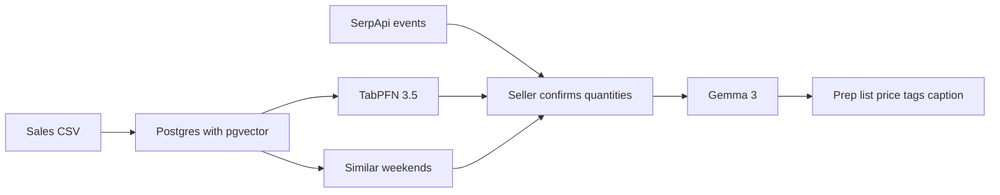

# StallSheet

StallSheet is a Sunday-morning desk for a home baker or craft-stall seller. Upload a small sales history and it tells you what to make, what to charge, and gives you a caption you can post.

The numbers come from a forecast. Gemma only writes the words, and the server throws away any price the model tries to slip into the caption.

This is a new project for the [Hacktoberfest Open-Source AI Challenge: Week 2](https://dev.to/challenges/hacktoberfest-week2-2026-10-12) (Side Hustle).

## Why someone would pay

Over-prep wastes ingredients. Under-prep loses the day's profit. A general chatbot is a poor fit: the useful part is a prediction on a few dozen of the seller's own rows, and those rows include margins they do not want in a closed chat log.

## How a sheet is built



Mastra runs that as one workflow and suspends on the confirm step, so the seller can change a quantity before anything is written. Workflow snapshots live in a local LibSQL file. Saving the finished sheet uses the Mastra run id as an idempotency key, because a restarted step can run more than once.

## Prize categories this project enters

- Best Use of Gemma
- Best Use of TabPFN
- Best Use of Mastra
- Best Use of Tiger Data

## Local setup

Node 22 or newer, and Docker.

```bash
cp .env.example .env
npm install
npm run db:up
npm start
```

Open http://localhost:3000. The Hearth & Rye bakery demo loads twelve Saturdays on first boot.

### Gemma

`GEMMA_BASE_URL` is any OpenAI-compatible chat endpoint.

- Local, sales history stays on the machine: `http://127.0.0.1:11434/v1` and `GEMMA_MODEL=gemma3:4b` (Ollama).
- Hosted Gemma: `https://generativelanguage.googleapis.com/v1beta/openai` and `GEMMA_MODEL=gemma-4-26b-a4b-it`, with `GEMMA_API_KEY` from Google AI Studio.

If the endpoint is down, the sheet still prints from a template and says so.

### TabPFN

Create a free non-commercial key at https://platform.priorlabs.ai and set `TABPFN_TOKEN`. The workflow fits TabPFN-3.5 (`v3.5_default`) to predict `qty_sold` at each price the seller has charged. Expected revenue, the price band, and the recommended quantity are computed in code.

Without a token, or if the call fails, the same screen uses a same-weather average and labels the source `baseline`.

### Tiger Data

Local Docker is Postgres 16 with pgvector, which is the same query path. For Tiger Cloud, replace `DATABASE_URL` with the service URL from the console (`sslmode=require`). Embeddings are a hashed bag of words stored in `pgvector`, so notes are not sent to an embedding API. Hybrid search fuses that vector rank with keyword rank. On Tiger, if `pg_textsearch` is installed, the keyword side uses BM25. Elsewhere it uses `tsvector`.

This entry does not use Render, a `.tech` domain, SerpApi, ElevenLabs, or Sentry. The app runs locally, with sales stored on Tiger Cloud.

## CSV

```text
weekend,item,price,qty_made,qty_sold,weather,notes
2026-07-04,Sourdough loaf,8.00,20,18,sunny,regular saturday
```

`price` is in dollars. `weekend` is `YYYY-MM-DD`.

## Tests

```bash
npm test
```

## License

MIT
